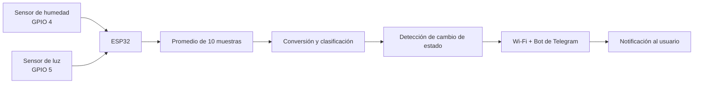

# Software - Documentación

## Contenido
Esta carpeta contiene todo el código y documentación del software del proyecto.

### 📁 Carpetas
sdsdsdsd
#### `src/`
Código fuente del proyecto (.ino para Arduino/ESP32)

#### `librerias/`
Librerías adicionales necesarias (no incluidas en Arduino IDE)

#### `docs/`
Documentación técnica del software

---

## Stack Tecnológico

Plataforma: Arduino / ESP32  
Lenguaje: C/C++  
IDE: Arduino IDE 2.x  
-----
**Librerías Principales**
| Librería | Función |  
|---|---|
| `WiFi.h` | Conexión del ESP32 a una red Wi-Fi Incluida en Arduino-ESP32 |
| `WiFiClientSecure.h` | Cliente para comunicación HTTPS, incluida en Arduino-ESP32 | 
| `UniversalTelegramBot.h` | Envío de mensajes mediante un bot de Telegram | 
| `esp_wpa2.h` | Autenticación WPA2 Enterprise, según el código del informe | 

---

## Instalación y Configuración

1. Instalar Arduino IDE
   1.Instalar Arduino IDE 2.x desde el sitio oficial de Arduino.
   2.Abrir el IDE y comprobar que permita detectar el puerto USB del microcontrolador.
2. Configurar ESP32/Arduino
   1.Abrir el Gestor de placas de Arduino IDE.
   2.Instalar el paquete esp32 by Espressif Systems.
   3.Conectar el ESP32 al computador mediante un cable USB que transfiera datos.
   4.Seleccionar en Herramientas > Placa el modelo que corresponda al dispositivo físico y elegir su puerto.
   5.Verificar la correspondencia de conexiones y pines con el montaje real.

### 3. Instalar Librerías
1. En **Programa > Incluir librería > Administrar bibliotecas**, buscar e instalar `UniversalTelegramBot`.
2. Verificar las dependencias que solicite esa versión de la librería, incluida ArduinoJson si corresponde.
3. `WiFi.h` y `WiFiClientSecure.h` se obtienen del paquete de placas ESP32.
4. Si el firmware utiliza la red WPA2 Enterprise, comprobar que las llamadas de autenticación sean compatibles con la versión instalada de Arduino-ESP32.
5. Registrar las versiones finalmente utilizadas en [`librerias/README.md`](librerias/README.md) y en [`../FUENTES.md`](../FUENTES.md).

### 4. Cargar Código
1. Incorporar a `src/` el archivo `.ino` definitivo del equipo.
2. Abrir el archivo en Arduino IDE.
3.Configurar credenciales Wi-Fi, token del bot y destinatario de Telegram sin publicar datos secretos en GitHub.
4. Comprobar el modelo de placa, las conexiones y las constantes de calibración.
5. Compilar y cargar el firmware en el ESP32.
6. Abrir el **Monitor Serial a 115200 baudios**, valor utilizado en el código incluido en el informe.
7. Verificar las lecturas de ambos sensores y provocar un cambio de categoría de humedad para comprobar la notificación.
---

## Configuración de Parámetros

Editar las siguientes constantes en el código:

// Entradas analógicas documentadas
#define PIN_HUMEDAD 4
#define PIN_LUZ 5

// Calibración del sensor capacitivo de humedad
const int RAW_SECO = 2965;
const int RAW_MOJADO = 2300;

// Intervalo de medición: 10.000 ms = 10 segundos
const long intervaloLectura = 10000;

// Variables de configuración de red y Telegram utilizadas en el informe:
// EAP_IDENTITY, EAP_PASSWORD, ssid, BOTtoken, CHAT_ID
// Sus valores reales NO deben publicarse en el repositorio.

*Clasificación de humedad*
| Humedad estimada | Estado | Interpretación |
|---|---|---|
| Menor a 25 % | Seco | Se recomienda revisar la necesidad de riego |
| 25–54 % | Óptimo | Humedad considerada adecuada según los umbrales del proyecto |
| 55–74 % | Húmedo | Sustrato con mayor contenido de agua |
| 75–100 % | Empapado | Posible exceso de riego |

*Clasificación lumínica*
| Lectura analógica KY-018 | Categoría |
|---|---|
| Mayor a 3000 | Oscuro |
| 2001–3000 | Sombra |
| 1001–2000 | Luz moderada |
| 0–1000 | Sol directo |

----
## Arquitectura del Software

### Diagrama de arquitectura del sistema

### Módulos Principales
1. Inicialización: configura el Monitor Serial, la conexión Wi-Fi y el cliente de Telegram; establece los pines y variables de control.
2. Lectura de Sensores: la función `promediarLectura(pin)` obtiene el promedio de 10 muestras de cada entrada analógica.
3. Procesamiento: `calcularPorcentajeHumedad(raw)` convierte la lectura de humedad a una escala de 0–100 %. obtener `CategoriaHumedad(...)` y `obtenerNivelLuz(...)` clasifican las condiciones.
4. Actuación: el prototipo documentado no controla bombas, válvulas ni otros actuadores físicos. Su respuesta consiste en avisos digitales al usuario, quien decide si debe regar.
5. Comunicación: mediante Wi-Fi y `UniversalTelegramBot`, `bot.sendMessage(...)` transmite una alerta cuando cambia el estado de humedad.

---

## API 
Se utilizó la API de bots de Telegram por medio de la librería `UniversalTelegramBot`

| Servicio / interfaz | Operación | Descripción |
|---|---|---|
| Telegram Bot API | `bot.sendMessage(...)` | Envía notificaciones cuando cambia la categoría de humedad |
| Wi-Fi | Conexión de red | Permite al ESP32 comunicarse con Telegram |
| Dashboard / API de almacenamiento | Por definir | No se encontró implementación ni URL verificable en el ZIP |.
